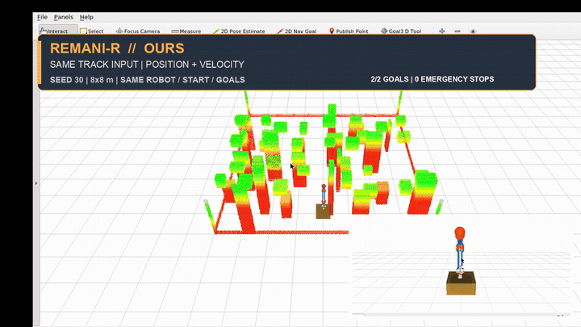

# REMANI-R

**Recoverability-Aware Spatio-Temporal Planning for Mobile Manipulators**

REMANI-R extends the REMANI whole-body planning loop with braking-distance
awareness, joint recovery-time constraints, trajectory-arrival-time dynamic
obstacle queries, execution-time auditing, and path-preserving temporal repair.

## Core Capabilities

- whole-body braking and joint-recovery constraints;
- a final-time recoverability audit during planning and execution;
- exact polynomial time stretching when only recoverability fails;
- trajectory-arrival-time queries for moving spherical obstacles;
- field-aware randomized experiments and paired-statistics tooling.

## REMANI-R Fair Dynamic Benchmark

The original REMANI, REMANI-R, and TopAY use the same 8 × 8 m map, robot,
start, goals, and moving-sphere track. REMANI-R predicts the sphere at each
trajectory-arrival time.

[](research/media/fair_remani_r_dynamic.mp4)

**REMANI-R: 2/2 goals, 0 emergency stops.**

[Watch the full-resolution MP4](research/media/fair_remani_r_dynamic.mp4) ·
[Protocol and three-way results](research/docs/fair_dynamic_benchmark.md)

## Measured Performance

### Dynamic mission

Seeds `30-34`, 20 ground obstacles, 30 floating obstacles, and two crossing
spheres:

| Metric | REMANI-R |
|---|---:|
| Mission success | `5/5` |
| Mean planning time | `276.8 ms` |
| P95 planning time | `357.7 ms` |
| Mean trajectory time | `18.72 s` |
| Safety violations | `0` |
| Runtime replans | `0` |
| Emergency stops | `0` |

### REMANI comparison

| Method | Runs | Mean planning | P95 planning | Safety violations | Emergency stops |
|---|---:|---:|---:|---:|---:|
| REMANI | 3 | `214.0 ms` | `289.5 ms` | `9` | `1` |
| REMANI-R | 3 | `258.4 ms` | `305.5 ms` | `0` | `0` |

### Static regression

| Scene | Seeds | Success | Mean planning | P95 planning | Safety violations |
|---|---:|---:|---:|---:|---:|
| `exp0` | 5 | `5/5` | `243.7 ms` | `286.4 ms` | `0` |
| `exp1_random` | 5 | `5/5` | `235.3 ms` | `293.7 ms` | `0` |

### External baselines

TopAY completed `52/100` cases in its native randomized benchmark, with
`122.17 ms` mean planning time on successful cases. In the published GCDF
benchmark at 120 obstacles, REMANI reached `49.6%`, TopAY `51.6%`, GCDF
`86.8%`, and GCDF with TopAY initialization `91.6%`.

- [TopAY benchmark and environment](research/external/TOPAY_COMPARISON.md)
- [GCDF published comparison](research/external/GCDF_COMPARISON.md)

## Research Pipeline

The research pipeline is under [`research/`](research/README.md):

```text
research/
├── configs/       planner modes, scenarios and study matrices
├── pipeline/      experiment execution, metrics and statistics
├── scenarios/     dynamic-obstacle and mission completion tools
├── capture/       RViz recording and video composition
├── runs/          immutable results for each study execution
├── results/       canonical, ablation and historical tables
├── external/      original REMANI, TopAY and GCDF comparisons
├── media/         final videos
├── figures/       final figures and contact sheets
└── archive/       raw videos, logs and trajectories
```

Run a complete study:

```bash
python3 research/pipeline/run_study.py \
  research/configs/studies/dynamic_fair_v1.toml
```

Core technical notes:

- [REMANI-R](research/REMANI_R.md)
- [Dynamic planning](research/docs/DYNAMIC_PLANNING.md)
- [Recoverability](research/docs/REVERSIBLE_PLANNING.md)
- [Performance](research/docs/PERFORMANCE.md)
- [Experiments](research/docs/EXPERIMENTS.md)

## Build and Run

Environment: Ubuntu 20.04, ROS Noetic, x86_64.

```bash
sudo apt install libompl-dev libeigen3-dev
mkdir -p ~/remani_ws/src
cd ~/remani_ws/src
git clone https://github.com/helloaisvg/WBC.git remani-r
cd ~/remani_ws
catkin_make -DCMAKE_BUILD_TYPE=Release
source devel/setup.bash
```

Static dense-cuboid and bridge scenes:

```bash
roslaunch remani_planner exp0.launch
roslaunch remani_planner exp1.launch
```

Dynamic scenes:

```bash
roslaunch remani_planner dynamic_exp0.launch
roslaunch remani_planner dynamic_exp1.launch
```

## Robot Configuration

The FastArmer model is the default configuration. The UR5 example is included
in [`mm_param.yaml`](remani_planner/plan_manage/config/mm_param.yaml).

Robot geometry and visualization are implemented in:

- [`mm_config.cpp`](remani_planner/mm_config/src/mm_config.cpp)
- [`remani_planner_param.yaml`](remani_planner/plan_manage/config/remani_planner_param.yaml)

## Results and Data

- Canonical final tables: [`research/results/canonical`](research/results/canonical)
- Ablation and baseline tables: [`research/results/tables`](research/results/tables)
- External comparisons: [`research/external`](research/external)
- Final videos: [`research/media`](research/media)
- Figures and contact sheets: [`research/figures`](research/figures)

## Upstream REMANI

REMANI-R builds on the REMANI whole-body planner presented at ICRA 2024:

> Real-time Whole-body Motion Planning for Mobile Manipulators Using
> Environment-adaptive Search and Spatial-temporal Optimization

- Authors: Chengkai Wu, Ruilin Wang, Mianzhi Song, Fei Gao, Jie Mei, and Boyu Zhou
- Paper: [IEEE Xplore](https://ieeexplore.ieee.org/document/10610192)
- DOI: [10.1109/ICRA57147.2024.10610192](https://doi.org/10.1109/ICRA57147.2024.10610192)

```bibtex
@INPROCEEDINGS{10610192,
  author={Wu, Chengkai and Wang, Ruilin and Song, Mianzhi and Gao, Fei and Mei, Jie and Zhou, Boyu},
  booktitle={2024 IEEE International Conference on Robotics and Automation (ICRA)},
  title={Real-time Whole-body Motion Planning for Mobile Manipulators Using Environment-adaptive Search and Spatial-temporal Optimization},
  year={2024},
  pages={1369-1375},
  doi={10.1109/ICRA57147.2024.10610192}
}
```

MINCO and AutoTrans provide the trajectory and planning framework used by the
upstream implementation. The source is released under the
[GPLv3](https://www.gnu.org/licenses/) license.
