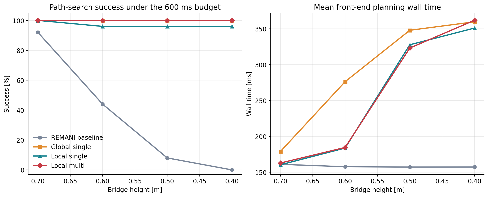

# Original REMANI Bridge Ablation

This experiment reproduces the local whole-body path-search ablation from
Table I of the REMANI paper and separates its two design choices:

- repairing only the interrupted path segment versus re-running whole-body
  search over the complete path;
- one start-goal pair versus all boundary states from both interrupted trees.

## Implementation

The experiment starts from the public `LNS-REMANI` implementation. The released
local RRT code did not return a connection for the 0.5 m bridge even after
10 seconds and 11,329 expanded nodes. The formal comparison therefore connects
the same interrupted-tree boundary states through OMPL 1.6 `RRTConnect`.
A*, robot geometry, collision checking, bridge construction, trajectory
initialization, start, goal, and the 600 ms budget remain shared by all modes.

Four fallback modes are compared:

| Mode | Search region | Start-goal set |
|---|---|---|
| `none` | no fallback | original REMANI front end |
| `global_single` | complete path | one original start and one goal |
| `local_single` | interrupted segment | best boundary pair |
| `local_multi` | interrupted segment | all boundary start and goal states |

## Protocol

- Map seed: `30`.
- Map: 8 m × 8 m bridge.
- Bridge heights: `0.7`, `0.6`, `0.5`, and `0.4 m`.
- Robot: FastArmer mobile manipulator.
- Start: `[-2.0, 1.5]`.
- Goal: `[2.0, 1.5]`.
- Paired RRT seeds: `7000` through `7024`.
- Trials per cell: `25`.
- Front-end search budget: `600 ms`.
- Shared maximum search times: A* `0.5 s`; whole-body fallback `0.2 s`;
  manipulator search `0.05 s`.
- Local base-sampling margin: `1.0 m`.
- Success: the front end returns a collision-checked whole-body path within
  `600 ms`.
- Wall time: complete A*, initial whole-body search, and selected fallback.

The front-end metric isolates the search design tested by Table I from the
downstream L-BFGS trajectory-refinement stage.

## Success And Runtime

| Bridge [m] | Baseline success | Global single | Local single | Local multi | Baseline mean [ms] | Global mean [ms] | Local single mean [ms] | Local multi mean [ms] |
|---:|---:|---:|---:|---:|---:|---:|---:|---:|
| 0.7 | 92% | 100% | 100% | 100% | 160.95 | 178.78 | 160.28 | 162.75 |
| 0.6 | 44% | 100% | 96% | 100% | 157.60 | 276.10 | 183.61 | 184.45 |
| 0.5 | 8% | 100% | 96% | 100% | 157.16 | 347.79 | 327.58 | 323.04 |
| 0.4 | 0% | 100% | 96% | 100% | 157.24 | 359.56 | 350.85 | 361.72 |

## Paired Comparisons

All comparisons use the same seed in every mode. Runtime differences use
Wilcoxon signed-rank tests on the 25 paired runs.

| Bridge [m] | Local multi − global single [ms] | p | Local multi − local single [ms] | p |
|---:|---:|---:|---:|---:|
| 0.7 | −16.03 | 0.275 | +2.47 | 0.0074 |
| 0.6 | −91.66 | 0.00010 | +0.84 | 0.560 |
| 0.5 | −24.75 | 0.00033 | −4.54 | 0.711 |
| 0.4 | +2.17 | 0.063 | +10.87 | 0.00012 |

Baseline-to-repair success changes:

| Bridge [m] | Global single | Local single | Local multi |
|---:|---:|---:|---:|
| 0.7 | +2/25, p=0.50 | +2/25, p=0.50 | +2/25, p=0.50 |
| 0.6 | +14/25, p=1.2e-4 | +13/25, p=2.4e-4 | +14/25, p=1.2e-4 |
| 0.5 | +23/25, p=2.4e-7 | +22/25, p=4.8e-7 | +23/25, p=2.4e-7 |
| 0.4 | +25/25, p=6.0e-8 | +24/25, p=1.2e-7 | +25/25, p=6.0e-8 |

## Result

The original Table I trend is reproduced: REMANI without a failed-search
fallback drops from `92%` success at 0.7 m to `0%` at 0.4 m.

The design-choice claim does not hold across the four bridge heights. A
single-start, single-goal global re-search also reaches `100%` at every height.
The full local multi-start/multi-goal method is significantly faster than
global re-search at 0.5 m and 0.6 m by `24.75 ms` and `91.66 ms`, respectively.
At 0.4 m it is `2.17 ms` slower, and at 0.7 m the `16.03 ms` mean difference is
not significant.

Multi-start/multi-goal recovers one additional successful seed over local
single at 0.6, 0.5, and 0.4 m. It is `2.47 ms` slower at 0.7 m and `10.87 ms`
slower at 0.4 m on paired successful runs. Table I therefore proves that a
failed-search fallback is necessary, while it does not establish local
multi-start/multi-goal as the best repair strategy at every bridge height.

## Files

- `raw.csv`: all 400 trial records.
- `summary.csv`: 16 grouped cells with mean and P95 wall time.
- `logs/`: full ROS and planner output for all 16 cells.
- `bridge_ablation.py`: matrix runner and aggregation.
- `bridge_ablation.png`: success and runtime comparison.
