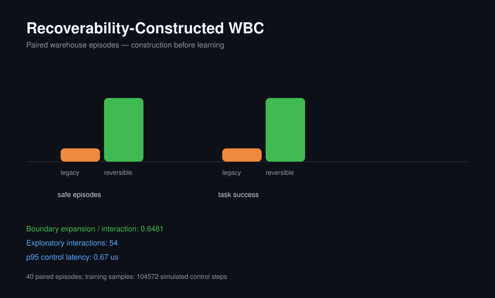

# Warehouse Reversibility Experiment

The benchmark runs the same route, seeds, payload masses, friction values, and disturbance phases in both arms.

| Outcome | Legacy command | Constructed shell + learned expansion |
|---|---:|---:|
| Task success | 12.50% | 60.00% |
| Irreversible event rate | 87.50% | 40.00% |
| Shell trigger rate | 0.00% | 1.95% |
| Boundary expansion / interaction | 0.0000 | 0.6481 |
| Mean completion time | 21.98 s | 31.46 s |
| p95 control latency | 0.29 us | 0.67 us |

Training trials: 28028. Exploratory interactions in the reversible arm: 54. New boundary certificates: 35.

