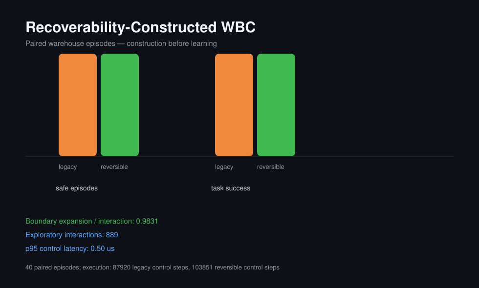

# Warehouse Reversibility Experiment

The benchmark runs the same route, seeds, payload masses, friction values, and disturbance phases in both arms.

| Outcome | Legacy command | Constructed shell + learned expansion |
|---|---:|---:|
| Task success | 100.00% | 100.00% |
| Irreversible event rate | 0.00% | 0.00% |
| Shell trigger rate | 0.00% | 0.19% |
| Boundary expansion / interaction | 0.0000 | 0.9831 |
| Mean completion time | 21.98 s | 25.96 s |
| p95 control latency | 0.21 us | 0.50 us |

Training trials: 34028. Exploratory interactions in the reversible arm: 889. New boundary certificates: 874.

